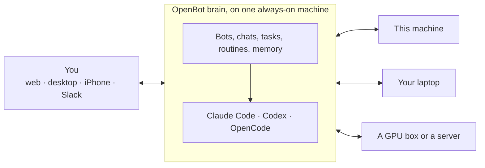

<h1 align="center">OpenBot</h1>

<p align="center">
  <strong>A team of AI bots that work for you, from a server you own.</strong><br>
  Give each bot a job, a coding agent and a computer, then chat with them like colleagues: one to one
  or in groups, from your browser, your desktop or your phone.
</p>

<p align="center">
  <a href="#quick-start">Quick start</a> ·
  <a href="#why-openbot">Why OpenBot</a> ·
  <a href="#how-it-fits-together">How it fits together</a> ·
  <a href="#development">Development</a>
</p>

<picture>
  <source media="(prefers-color-scheme: dark)" srcset="docs/images/chat-dark.webp">
  
</picture>

## Why OpenBot

OpenBot is a self-hosted take on Grok Bot, built around three ideas: many bots, the agents and
subscriptions you already have, and real computers for them to work on.

### A team of bots, not one chatbot

Each bot has its own name, look, instructions, memory, skills and model. Chat with one directly, or put
several in a group and @mention who should answer; bots also message each other and hand work off.
They keep going when you leave: background tasks, routines on a schedule or on a Slack message, and a
card in the chat when they need your approval or an answer. New bots introduce themselves and ask what
you want to do first.


### Your agents, your subscriptions

Every bot runs on a real coding agent: **Claude Code**, **Codex** or **OpenCode**, mixed however you
like in one team. There are no API keys to paste: OpenBot uses the sign-ins the agents' own CLIs
already have, so your bots run on the subscriptions you already pay for. Several Claude accounts, say a
personal and a work one? Add them all, and pick per bot which one it uses and which model.


### Many machines, real computers

The brain runs on one always-on machine: a home server, a VPS, or the computer you're on. Bots do
their work on any computer you pair with one command, Linux or macOS. Computers dial out to the brain,
so they work behind NAT. Put each bot where its work is: the box with the GPU for the bot that makes
videos, your laptop for the one that works in your repos.

On Linux every bot gets its own desktop with a browser, terminal and editor. On a Mac, bots use the
Mac's own screen while you're away from it. Watch any of them live, take over with your own mouse and
keyboard, and hand it back.


### With you everywhere


- **Apps:** the web app works on desktop and phone; the desktop app (macOS, Linux, Windows) adds
  notifications and a shortcut that sends whatever you're looking at to a bot; and there is a native
  iPhone app.
- **Voice:** dictate a message, or call a bot and just talk (experimental). Speech is heard and spoken
  on your own server; the bot itself does the thinking and the talking.
- **Search** every chat from ⌘K, jump to any old message, and find within a chat with ⌘F.
- **Slack:** hand a thread to a bot from Slack, let bots read and search it, and send their drafts
  yourself.
- **Skills:** a shared library you assign to bots, with imports from [skills.sh](https://skills.sh). Type `/` in a chat to start one of the bot's skills.

<br clear="right">

### Yours

One owner, one server, your data in SQLite on it. Agent sign-ins and app tokens stay on that machine,
and so does your voice. Updates deploy in seconds without cutting a bot off mid-task: running work gets
time to finish, and anything left is saved and picked up by the new version.

## How it fits together



The brain keeps the bots, their chats and memory, and runs each bot's agent with your sign-in. The
agents' tools run on the computer the bot is set to use, through a small node program on each paired
computer. You reach the brain over HTTPS from any of the apps.

## Requirements

- [Bun](https://bun.com) 1.4.4 or newer.
- At least one coding agent, signed in on the machine that runs OpenBot:
  - **Claude:** `claude auth login` (Claude Code CLI). OpenBot uses the Claude Agent SDK.
  - **Codex:** install the `codex` CLI and run `codex login`.
  - **OpenCode:** install [OpenCode](https://opencode.ai) and connect a provider.

  Settings › Harnesses shows which ones are ready and what's missing.

- **Optional:** Google Chrome or Chromium, so bots can use a browser.
- **Optional, Linux only:** the desktop programs listed under [Bot desktops](#bot-desktops-linux).

## Quick start

```sh
git clone https://github.com/Leka74/openbot.git
cd openbot
bun install
bun run start
```

OpenBot prints a login link such as `http://127.0.0.1:7420/?token=…`. Open it and create your first
bot. The token is created on the first run and stays the same afterwards.

Data lives in `~/.local/share/openbot` (or `$XDG_DATA_HOME/openbot`). Bot workspaces default to
`~/openbot`.

### Options

```text
--data-dir <path>       Data directory
--port <n>              Port (default 7420)
--host <host>           Bind address (default 127.0.0.1)
--public-origin <url>   Extra origin OpenBot is reached at, e.g. https://box.tailnet.ts.net (repeatable)
--harness <list>        Coding agents to enable, comma separated (default: claude,codex,opencode)
--no-local-node         Don't let bots use this machine
--desktop-idle <min>    Put an unused bot desktop to sleep after this many minutes (default 10; 0 = never)
--dev                   Hot reload for development
```

Every option also reads an environment variable (`OPENBOT_PORT`, `OPENBOT_DATA_DIR`, …). Run
`bun apps/server/src/main.ts --help` for the full list.

## Use it from your phone

OpenBot listens on `127.0.0.1` only. To reach it from other devices, put it behind something that
adds HTTPS, and pass that address as `--public-origin`. With [Tailscale](https://tailscale.com):

```sh
tailscale serve --bg --https=8444 http://127.0.0.1:7420
bun run start -- --public-origin https://<machine>.<tailnet>.ts.net:8444
```

Then open the printed login link on your phone. After that, any other browser can sign in without the
link: open OpenBot's address there, choose **Sign in with another device**, and on a device where you're
already signed in pick the number that browser shows.

## Run it on a home server

The brain doesn't have to live on the computer you work on. To keep it on an always-on machine (a home
server, an LXC container, a VPS) and deploy to it from your own:

1. On the server: install Bun and the agents, and sign them in there (`claude auth login`, `codex login
--device-auth`, and `gh auth login` if your bots use GitHub). Install
   [`scripts/openbot.service`](scripts/openbot.service) as a user service (its header has the
   steps). It starts OpenBot at boot and again after a crash.
2. On your computer, point deploys at the server: `{ "host": "<ssh host>" }` in
   `~/.config/openbot/deploy.json`, or `--to <ssh host>` each time. The first deploy also gives the
   server's arguments:

   ```sh
   bun run deploy -- --port 7420 --host 0.0.0.0 --public-origin https://openbot.example.com
   ```

3. Put HTTPS in front of it (Caddy, Tailscale Serve, …), then pair the computers your bots should work
   on, including the one you develop on ([Connect other computers](#connect-other-computers)).

After that, `bun run deploy` copies only what changed to the server over SSH and updates OpenBot there
as described below, in about ten seconds.

## Updating a running OpenBot

`bun run deploy` ships the working tree to the OpenBot that is running, without losing your Bots'
work:

```sh
bun run deploy              # bots get up to 3 minutes to finish, then the rest is saved and resumed
bun run deploy --grace 10m  # wait longer for running work
bun run deploy --now        # restart right away (work is still saved and resumed)
```

It copies the repo into a new release under `~/.local/share/openbot-releases` (unchanged files are
hard links, so it is quick), checks that it loads, and asks the running OpenBot to drain: no new
reply or task starts (your messages wait, shown as queued), running ones get the grace period. Then
it backs up the database, starts the new release with the same arguments and switches over in about
a second. Messages that waited are answered, and Bots that were cut off mid-reply or mid-task pick
up where they were. If the new release does not start, the previous one is started again.

## Bot desktops (Linux)

On Linux, each bot can have its own virtual screen, 1920×1200 by default. Bots see it through
screenshots and drive it with the mouse and keyboard. You watch it in the web app, and can take
control whenever you want. When a bot needs you, for example to sign in somewhere, it hands the
screen over to you.

Install the required programs, plus the optional ones for a complete desktop:

|          | Arch                                                      | Debian / Ubuntu                                               |
| -------- | --------------------------------------------------------- | ------------------------------------------------------------- |
| Required | `xorg-server-xvfb x11vnc xdotool xfwm4 imagemagick`       | `xvfb x11vnc xdotool xfwm4 imagemagick`                       |
| Optional | `plank dbus xfce4-terminal thunar mousepad xorg-xsetroot` | `plank dbus xfce4-terminal thunar mousepad x11-xserver-utils` |

`openbox` works in place of `xfwm4`, and `xterm` in place of `xfce4-terminal`. Settings ›
Computers shows anything that is still missing.

On macOS, bots use the Mac's own screen instead, with its apps and your logins: one bot at a time,
and only while you are away from it (no keyboard or mouse use for 20 seconds). Turn on **This
Mac's screen** for the computer in Settings › Computers, then allow Screen Recording and
Accessibility for `openbot-node` in System Settings › Privacy & Security.

## Connect other computers

The machine running OpenBot is a computer your bots can use. You can add more, such as a server or
another laptop:

1. In the web app, open Settings › Computers and click **Pair a computer**.
2. Run the command it shows on the other machine (Linux or macOS):

   ```sh
   curl -fsSL https://<your-openbot>/node/install.sh | sh -s -- <code>
   ```

   It downloads the node from your OpenBot (built from the same source, so they always match), puts
   it in `~/.local/bin`, pairs it with the one-time code, and keeps it running as a user service
   (systemd on Linux, launchd on macOS).

To update the node later, run the same command without the code: it replaces the program and
restarts it, and the pairing stays.

The other machine must be able to reach OpenBot, for example over the address you set up in
[Use it from your phone](#use-it-from-your-phone). Run `openbot-node --help` there for the options:
workspace folders, read-only folders, how much the computer allows without asking, and the browser.

Without the installer, from a clone of this repository: `bun apps/node/src/main.ts pair <openbot-url> <code>`,
then `bun apps/node/src/main.ts run`.

## Connect apps

**Connect apps** at the bottom of the sidebar lists the apps your Bots can use, which of them are
connected, and each app's setup. Slack is the first.

### Slack

Bots can read and search your Slack, start routines when someone messages you, and draft messages
that you send yourself. It uses a Slack app of your own, so nothing goes through anyone else:

1. **Connect apps** (bottom of the sidebar) › Slack › **Create in Slack** opens Slack's "Create an app" with OpenBot's app filled in
   (or copy the manifest and use Create New App › From a manifest). Pick your workspace and create it.
2. In the app, **Install App** › Install to your workspace › Allow, then paste the **User OAuth
   Token** (`xoxp-…`) into OpenBot.
3. Optional, for routines that start on Slack messages: Basic Information › App-Level Tokens ›
   Generate Token and Scopes with `connections:write`, and paste it (`xapp-…`).

The tokens stay on the machine that runs OpenBot (`<data>/slack.json`). Live messages use Slack's
Socket Mode, which connects out, so OpenBot doesn't need to be reachable from the internet. A Bot never
writes in Slack by itself: it shows you a **Slack message** draft in the chat, which you edit and send
(it goes out as you) or discard. A draft can carry files the Bot made (a video, an image, a PDF):
they're uploaded with the message when you send it. An app created before that existed needs its
manifest updated once for the `files:write` permission: Connect apps › Slack shows the steps. To start a Bot when someone DMs you, mentions you or says a phrase,
add a routine with the **Slack** trigger (Details › Routines), or ask the Bot.

To hand a Slack message or thread to a Bot, use **⋯ › Send to OpenBot** on the message in Slack. It
lands in the chat of the Bot you pick under Connect apps › Slack (or the Bot you chatted with last),
with its link, and the Bot reads the whole thread. Mentioning **@OpenBot** in a message you write (pick
it from Slack's suggestions) does the same, e.g. "@OpenBot remind me of this tomorrow"; you can turn
that off under Connect apps › Slack. Both need live messages on. An app created before
this option existed needs its manifest updated once: Connect apps › Slack has the steps.

### Hark: notifications on your iPhone

Until the OpenBot iPhone app has push notifications, [Hark](https://hark.ryan.ceo) can bring them to
your phone. Install Hark on the iPhone, create a service called OpenBot in Hark's web dashboard
(hark.ryan.ceo; the app has no such option), and paste its webhook URL under Connect apps › Hark. OpenBot sends a test notification, then pushes every notification it makes (or only the ones
where a Bot needs you), grouped by Bot. Tapping one opens that chat, through the address you gave
`--public-origin`.

## Voice

Settings › General has two switches. **Voice input** adds a mic button to the message box: you talk,
OpenBot types (Parakeet). **Voice calls** (experimental) put a call button in an empty message box:
you talk with the bot, it answers out loud (Kokoro, with a voice you choose per bot), and you can talk
over it like you would with a person. Both download their speech models once, a few hundred MB each,
and run on the brain: your voice never leaves your server.

## Desktop app

OpenBot also runs in its own window on macOS, Linux and Windows, with your Bots' updates as the
computer's notifications and an unread badge. It keeps running when you close the window, so the
notifications keep coming. Download it under Settings › General › Apps: your OpenBot builds it for
that computer on the first download (about a minute) with its own address inside, so there is
nothing to set up. On macOS and Linux you can also install it from a terminal, which on a Mac skips
the one-time "Open Anyway" prompt for apps from outside the App Store:

```sh
curl -fsSL https://<your-openbot>/desktop/install.sh | sh
```

On first start the app shows a code and opens OpenBot in your browser: click **Allow** there and
the app signs in. It updates itself from your OpenBot: when there is a new version it downloads it
in the background and shows **Restart to update** in the sidebar (Settings › General › Apps and the
app menu can also check right away).

**Quick send:** press ⌥⌘O (Ctrl+Alt+O on Linux and Windows) anywhere to send what you're looking at
to a Bot: the page open in your browser, something you just copied, or a screenshot, plus a note.
On a Mac, **Add to the Share menu** (Settings › General › Apps) adds "Send to OpenBot" to the Share
menu and to right-click › Services. Raycast, Alfred and Shortcuts can open
`openbot://send?text=…&url=…&to=…`, and the **Send to OpenBot** bookmarklet on the same page works
in any browser. Nothing is sent until you press Enter. On Linux you can also bind a key to
`openbot-desktop --quick-send`. Notifications also work in the browser itself (turn on **Notifications on this
device** in the same section), but only while OpenBot is open there.

## iPhone app

`apps/mobile` is a native iPhone app (Expo) with the same chats, cards and live updates, in iOS's
liquid glass look. To try it without building anything, install **Expo Go** from the App Store and
start the dev server where your iPhone can reach it, for example over Tailscale. Expo Go on an
iPhone only opens projects from a dev server signed in to the same (free) Expo account as Expo Go,
so sign in once with `expo login` (or set `EXPO_TOKEN` to an access token from expo.dev):

```sh
tailscale serve --bg --https=8445 http://127.0.0.1:8081
cd apps/mobile && bunx expo login
EXPO_PACKAGER_PROXY_URL=https://<machine>.<tailnet>.ts.net:8445 bunx expo start
```

Open `exps://<machine>.<tailnet>.ts.net:8445` on the iPhone (or scan the QR code Expo prints), then
connect with the code under Settings › iPhone app in OpenBot.

## Development

```sh
bun run dev          # hot reload
bun fmt
bun run typecheck
bun run lint
bun run test
```

| Path                                                                     | What it is                                                                                |
| ------------------------------------------------------------------------ | ----------------------------------------------------------------------------------------- |
| `apps/server`                                                            | The brain: orchestration, coding agents, storage, the MCP tool gateway and the web server |
| `apps/web`                                                               | The web app (React)                                                                       |
| `apps/node`                                                              | The node daemon that connects another computer                                            |
| `apps/desktop`                                                           | The desktop app (Electron), built and served by the brain                                 |
| `apps/mobile`                                                            | The iPhone app (Expo)                                                                     |
| `packages/core`                                                          | Bots, conversations, tasks, routines, approvals, memory and skills                        |
| `packages/contracts`                                                     | Shared schemas and the RPC API                                                            |
| `packages/persistence`                                                   | SQLite storage and file stores                                                            |
| `packages/gateway`                                                       | The tools bots get, served over MCP                                                       |
| `packages/harness-*`                                                     | Claude, Codex and OpenCode adapters, plus a scripted fake for tests                       |
| `packages/node-daemon`, `packages/node-protocol`, `packages/brain-nodes` | Computers: shell, files, browser, desktops, and how they talk to the brain                |
| `packages/client`, `packages/ui`                                         | Web client state and UI components                                                        |

The screenshots in this README come from the web app's dev mock (made-up bots and chats):
`bun apps/web/test/shoot-readme.ts` takes them again after UI changes.

Design notes are in [`docs/`](docs): [architecture](docs/architecture.md),
[decisions](docs/decisions.md), [interfaces](docs/interfaces.md) and the
[node protocol](docs/node-protocol.md). If you work on the code with an agent, start with
[`AGENTS.md`](AGENTS.md).
