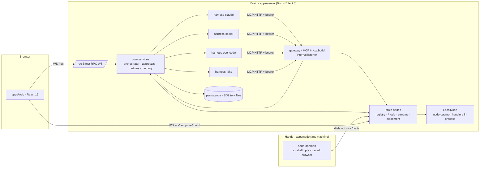

# OpenBot architecture

Implementation-grade architecture for OpenBot v1. **Binding inputs:** `docs/decisions.md` (D-numbers below) and the research in `docs/research/`. The work breakdown is in `docs/plan.md`.

> Reading guide for implementers: read §1–3 completely, then your package section in §4, then the flows in §5 that your package participates in.

---

## 1. Overview



- **Brain** (`apps/server`). One process runs:
  - the web UI and the app RPC;
  - orchestration and the harness agent loops (Claude Agent SDK `query()`, `codex app-server`, `opencode serve` children);
  - the OpenBot MCP gateway;
  - the node registry;
  - persistence.
- **Hands** (`apps/node`). A daemon on any machine. It dials out to the brain and serves `NodeRpcs`: fs, shell, pty, tunnel, service, forward and browser (CDP); computer actions come later.
  - The brain also embeds the same handlers in-process as the **local node** (`node_local`), which can be disabled.
- **Harness-agnostic product behaviour**: bot-to-bot messaging, questions, approvals, routines, memory and node tools. It reaches every harness through **one MCP gateway** (D3). It never relies on a harness-specific feature.

## 2. Package map and dependency direction

```
contracts ─┐                         (browser-safe, effect only)
node-protocol ─┤                     (browser-safe, effect only)
               ▼
             core  (ports + domain services; NO SDK / SQL / React / Bun APIs)
               ▼
  persistence · harness-{claude,codex,opencode,fake} · gateway · brain-nodes · node-daemon
               ▼
  apps/server (brain composition)     apps/node (daemon CLI)

  ui (React primitives, tokens)  ─┐
  client (atoms, RPC client)      ─┼─▶ apps/web
  contracts                       ─┘
```

| Package | Path | Depends on | Owns | Must not |
|---|---|---|---|---|
| `@openbot/contracts` | packages/contracts | effect | Domain + wire schemas, typed errors, `OpenBotRpcs`, replica stream items, client projection reducer, harness event (normalized) schemas | import Bun/DOM APIs |
| `@openbot/node-protocol` | packages/node-protocol | effect | `NodeRpcs`, `BrainRpcs`, node schemas/errors, stream kinds & framing, direction mux, Ed25519 + pairing helpers (WebCrypto), `PROTOCOL_VERSION` | import Bun-only APIs (must run in browser/Bun) |
| `@openbot/core` | packages/core | contracts, node-protocol, effect | Ports (§3), domain services (§4.3), in-memory test doubles | import any SDK, SQL, React, `Bun.*`, `node:*` (use Effect `Clock`, `Random`) |
| `@openbot/persistence` | packages/persistence | core, contracts, effect, @effect/sql-sqlite-bun, @effect/platform-bun | SQLite repositories, migrations, file stores (memory, skills, attachments), boot recovery | business rules |
| `@openbot/harness-fake` | packages/harness-fake | core, contracts, effect, @modelcontextprotocol/sdk | Deterministic scripted harness (tests, offline demo) | — |
| `@openbot/harness-claude` | packages/harness-claude | core, contracts, effect, @anthropic-ai/claude-agent-sdk | Claude driver/session/normalizer/probe | leak SDK types out of the package |
| `@openbot/harness-codex` | packages/harness-codex | core, contracts, effect, @openai/codex | app-server process mgmt, JSON-RPC peer, driver/session/normalizer/probe, CODEX_HOME setup | — |
| `@openbot/harness-opencode` | packages/harness-opencode | core, contracts, effect, @opencode/client | `opencode serve` mgmt, event hub, driver/session/normalizer/probe | — |
| `@openbot/gateway` | packages/gateway | core, contracts, node-protocol, effect, @modelcontextprotocol/sdk | MCP gateway HTTP handler, per-run tokens, toolkits (bot, node, browser) | — |
| `@openbot/node-daemon` | packages/node-daemon | node-protocol, effect, @effect/platform-bun | `NodeHandlersLive`, PathPolicy, NodePolicy, AuditLog, BrowserManager (CDP), DialOut + BrainLink, key store | depend on core |
| `@openbot/brain-nodes` | packages/brain-nodes | core, contracts, node-protocol, node-daemon, effect, @effect/platform-bun | NodeRegistry, NodeGateway (/node), StreamBroker (/node/stream), relay routes, LocalNode, PlacementService impl, ComputerService (screencast relay + control lease), pairing | — |
| `@openbot/ui` | packages/ui | react, lucide-react, (dev: tailwindcss) | Theme tokens (generated CSS), primitives, avatars, icon wrapper | fetch data |
| `@openbot/client` | packages/client | contracts, effect, @effect/atom-react, @effect/platform-browser | AtomRpc client, connection supervisor, subscription atoms (roster, conversation) with resume + reducer, command atoms | render UI |
| `@openbot/server` | apps/server | everything brain-side + @openbot/web | Composition root: config, data dir, listeners, auth, RPC handlers, boot sequence | business rules |
| `@openbot/web` | apps/web | ui, client, contracts, react, react-dom, @effect/atom-react, @xterm/xterm | Screens and app state | talk to SDKs |
| `@openbot/node` | apps/node | node-daemon, node-protocol, effect, @effect/platform-bun | Daemon CLI: `pair`, `run`, `status` | — |

Rules:
- Every package exports source (`"exports": {".": "./src/index.ts"}`); there is no build step except `bun build --compile` for `apps/node`.
- Every package has `typecheck: tsc --noEmit` and, where it has tests, `test: bun test`.
- Pin versions exactly through the root `catalog:`; effect is 4.0.4 (D4.5).

## 3. Core ports (the seams)

All ports are `Context.Service` classes in `packages/core/src/ports/`. Signatures use Effect 4 (`Effect.Effect<A, E, R>`, `Stream.Stream<A, E>`, `Scope.Scope`). Domain types come from `@openbot/contracts`.

### 3.1 Harness port

```ts
// packages/core/src/ports/Harness.ts
export type HarnessKind = "claude" | "codex" | "opencode" | "fake"   // contracts.HarnessKind (open string decoded, unknown kinds kept)

export interface HarnessCapabilities {
  readonly resume: boolean            // reopen a native session by id
  readonly steer: boolean             // inject user input into a running turn
  readonly interrupt: boolean
  readonly approvals: "interactive" | "policy-only" | "none"
  readonly questions: boolean         // native AskUserQuestion / requestUserInput / form
  readonly compact: boolean
  readonly contextUsage: boolean
  readonly images: boolean            // image attachments in user input
  readonly remotePlacements: ReadonlyArray<PlacementMode>   // which remote modes the driver implements
}

export interface HarnessDriver {
  readonly kind: HarnessKind
  readonly displayName: string                       // "Claude", "Codex", "OpenCode", "Fake"
  readonly capabilities: HarnessCapabilities
  readonly probe: Effect.Effect<HarnessStatus>       // installed? version? auth/account label? never throws; no model call
  readonly listModels: Effect.Effect<ReadonlyArray<ModelInfo>, HarnessError>
  readonly openSession: (input: OpenSessionInput) => Effect.Effect<HarnessSession, HarnessError, Scope.Scope>
}

// ONE session per bot (D5.0 "one mind per bot"), shared by all of its conversations.
export interface OpenSessionInput {
  readonly bot: Bot
  readonly conversationId: ConversationId            // the bot's HOME conversation (its DM)
  readonly sessionKey: string                        // sessionKeyOf(bot.id, bot.directConversationId)
  readonly nativeSessionId: string | undefined       // resume when defined
  readonly placement: ResolvedPlacement              // §3.3
  readonly instructions: RenderedInstructions        // §4.3.7 persona + team + memory index + node description
  readonly mcp: ReadonlyArray<McpBinding>            // §3.4; never put tokens on argv
  readonly model: string | undefined
  readonly effort: string | undefined
  readonly onRequest: (req: HarnessRequest) => Effect.Effect<HarnessRequestResolution>  // approvals & questions (blocks the native callback until resolved)
}

export interface HarnessSession {
  readonly events: Stream.Stream<HarnessEvent>       // hot, per session; normalized (contracts.HarnessEvent)
  readonly nativeSessionId: Effect.Effect<string | undefined>
  readonly startTurn: (input: TurnInput) => Effect.Effect<void, HarnessError>   // completes when ACCEPTED; turn end arrives as an event
  readonly steer: (input: TurnInput) => Effect.Effect<void, HarnessError>       // capability-gated; fails with HarnessError("unsupported") otherwise
  readonly interrupt: Effect.Effect<void>
  readonly compact: Effect.Effect<void, HarnessError>
  readonly contextUsage: Effect.Effect<ContextUsage | undefined>
}

export interface TurnInput {
  readonly turnId: TurnId
  readonly conversationId?: ConversationId            // the turn's conversation (replies, tools, cards land there)
  readonly text: string                               // rendered with origin tags + sender attribution (§4.3.2)
  readonly attachments: ReadonlyArray<{ readonly path: string; readonly mime: string; readonly name: string }>
}

// One driver per (kind, account/profile, D2.7); `profileId` absent = the harness's default account.
export class HarnessRegistry extends Context.Service<HarnessRegistry, {
  readonly get: (kind: string, profileId?: string) => Effect.Effect<HarnessDriver, HarnessUnavailable>
  readonly list: Effect.Effect<ReadonlyArray<HarnessDriver>>
}>()("openbot/HarnessRegistry") {}
```

**`HarnessEvent`** is defined in contracts (`packages/contracts/src/harness.ts`) as a tagged union. Adapters emit **whole items keyed by a stable native key**. Core allocates `EntryId`s and revisions, persists them and publishes them.

| `_tag` | Fields | Notes |
|---|---|---|
| `SessionBound` | `nativeSessionId` | persist ASAP |
| `TurnStarted` | `turnId`, `initiator?: "harness"` | `"harness"`: a turn the harness started itself (adapter id; core joins it to the running turn or runs it as a "system" turn, D2.1) |
| `ItemUpserted` | `key`, `item: HarnessItem`, `turnId` | `HarnessItem` = `Message{role:"bot", text, streaming, phase?, aborted?}` \| `Reasoning{text, streaming}` \| `ToolCall{toolName, title, kind: shell\|file-read\|file-edit\|search\|web\|mcp\|browser\|computer\|subagent\|other, status: pending\|running\|completed\|failed\|declined, inputSummary, outputPreview?, nodeId?, parentKey?}` \| `Notice{level, text}` |
| `Activity` | `label` (e.g. "Searching the web", "Typing…"), `toolKind?` | drives the activity row |
| `Usage` | `usage: contracts.Usage` | per step or turn |
| `ContextUsage` | `usedTokens`, `windowTokens` | |
| `TurnCompleted` | `turnId`, `stopReason?` | finalize all streaming items of the turn |
| `TurnFailed` | `turnId`, `error: {code, message, retryable}` | |
| `TurnInterrupted` | `turnId` | mark streaming bot text `aborted` |
| `SessionClosed` | `reason` | runner reopens with resume on next turn |

`HarnessRequest` is an approval or question raised by the native harness:
- `{kind: "tool-approval"|"command-approval"|"file-approval"|"mcp-approval", toolName, title, detail, command?, paths?, nodeId?, suggestions?}`
- `{kind: "question", questions: [{id, prompt, options[], multiSelect, allowFreeText}]}`

`HarnessRequestResolution`:
- `{decision: "allow-once"|"allow-session"|"allow-always"|"deny"|"cancel", message?}`
- `{answers: Record<id, string|string[]>}` for questions

The adapter maps these to native replies (domain-contract.md §F.8).

### 3.2 Repositories (implemented by persistence; in-memory doubles in `core/src/testing`)

`BotRepo` (incl. the bot's ONE native session `botId → {driver, nativeSessionId, seen: {conversationId → entryId}, lastConversationId}`, D5.0), `ConversationRepo` (incl. members), `EntryRepo` (upsert by id with revision guard, page by cursor, tail window), `RequestRepo`, `TurnRepo`, `RoutineRepo` (+ runs, keep last 20), `NodeRepo` (nodes, public keys, approved capabilities, pairing codes), `ApprovalRuleRepo`, `SettingsRepo` (typed key/values), `UsageRepo`, `ReplicaLog` (per-replica `{epoch, sequence}` and the last 256 changes per replica, for resume), `MemoryStore` (files: `<data>/bots/<id>/memory/MEMORY.md` + fact files), `SkillStore` (files: `<data>/skills-lib/skills/<name>/SKILL.md`), `AttachmentStore` (files: `<data>/attachments/<id>`), `McpTokenRepo` (sha256 → binding claims, revocable), `ProcessLedger` (pids/pgids of children, to kill at boot).

All repos return `Effect<_, RepoError>`. RepoError is a defect-like tagged error, which services map to `Internal` at the RPC edge.

### 3.3 Placement port

```ts
export type PlacementMode = "native-local" | "brain-mcp-hands" | "codex-environment"   // later: "claude-cli-on-node" | "opencode-on-node"
export interface ResolvedPlacement {
  readonly mode: PlacementMode
  readonly hostNodeId: NodeId                       // node_local when colocated
  readonly workspacePath: string                    // absolute path ON the host node
  readonly harnessCwd: string                       // cwd for the harness process (brain path; equals workspacePath for native-local)
  readonly env: Readonly<Record<string, string>>
  readonly disableBuiltinTools: boolean             // B1
  readonly codexEnvironment?: { readonly environmentId: string; readonly execServerUrl: string; readonly authBearerToken: string; readonly cwd: string }
  readonly toolsets: ReadonlyArray<"bot" | "node" | "browser" | "computer">
  readonly promptAppend: string                     // describes where tools run, node OS, workspace
  readonly release: Effect.Effect<void>             // relays/tunnels torn down
}
export class PlacementService extends Context.Service<PlacementService, {
  readonly resolve: (input: { bot: Bot; driver: HarnessDriver }) => Effect.Effect<ResolvedPlacement, PlacementError, Scope.Scope>
}>()("openbot/PlacementService") {}
```

Rules (D1.5):
- `hostNodeId === node_local` (or unset) → `native-local`.
- Remote host node:
  - Codex + node advertises `codex.exec-server` → `codex-environment`;
  - otherwise → `brain-mcp-hands` with `disableBuiltinTools: true` and toolsets including `"node"`.
- `browser` and `computer` toolsets are added when the host node advertises those capabilities.

### 3.4 Gateway binding and node access

```ts
export interface McpBinding { readonly name: "openbot"; readonly url: string; readonly headers: Readonly<Record<string, string>> }
export class McpBindingIssuer extends Context.Service<McpBindingIssuer, {
  // mints a per-session bearer bound to {botId, conversationId (home = DM), sessionKey, toolsets, hostNodeId, boundNodeIds};
  // revoked when the scope closes. Per tool call the gateway substitutes the conversation of the bot's running turn.
  readonly issue: (claims: McpClaims) => Effect.Effect<McpBinding, never, Scope.Scope>
}>()("openbot/McpBindingIssuer") {}

export class NodeDirectory extends Context.Service<NodeDirectory, {
  readonly list: Effect.Effect<ReadonlyArray<NodeSummary>>
  readonly changes: Stream.Stream<NodeSummary>
  readonly client: (nodeId: NodeId) => Effect.Effect<NodeClient, NodeUnavailable>   // NodeClient = RpcClient of node-protocol NodeRpcs
  readonly capabilities: (nodeId: NodeId) => Effect.Effect<ReadonlyArray<string>, NodeUnavailable>
}>()("openbot/NodeDirectory") {}
```

`node_local` is always present in `NodeDirectory` unless it is disabled by config.

### 3.5 Other ports

- **`Notifier`**: pushes OS/web notifications. v1 is web-only, published to clients via the roster.
- **`IdGen`**: prefixed ULIDs, e.g. `bot_…`, `cnv_…`, `ent_…`, `req_…`, `trn_…`, `rtn_…`, `run_…`, `nod_…`.
- **`DataDir`**: `{ root, botDir(id), workspaceDir(id), skillsLib, codexHome, attachments }`.
- **`ComputerPort`**: `status(botId)`, `ensure(botId)`; implemented by brain-nodes.

## 4. Packages in detail

### 4.1 contracts

Port `vendor/scratch/contracts/src` (domain-contract.md §F.4) and extend it. Files:

- `base.ts`: IDs (branded), Millis, Usage, Author, `withUnknownFallback`.
  - **Change `HarnessKind` to `"claude" | "codex" | "opencode" | "fake"`.**
- `domain.ts`
  - **Bot:** `id, name, label?, avatar {shape, color}, harness {kind, model?, effort?, profileId?}, hostNodeId (default node_local), boundNodeIds[], instructions, directConversationId, sectionId?, pinned, hidden, notify: all|mentions|none, createdAt, updatedAt`.
  - **BotActivity.**
  - **Conversation** (direct | group | routine-run) and its summary. A group adds `leadBotId`.
  - **Section** `{id, name, order}`.
  - **Routine** with `RoutineTrigger`:
    - `{type:"cron", schedule, timezone}`, `{type:"interval", everyMinutes ≥ 5}`, `{type:"once", at}`, `{type:"manual"}`; `webhook` is decode-only/later.
    - `RoutineRun {id, routineId, startedAt, finishedAt?, status, conversationId, turnId?, summary?}`.
  - **Node:** `NodeSummary {id, label, kind: local|remote, status, capabilities[], platform, hostname, roots[], lastSeenAt}`.
  - **Pairing:** `{code, expiresAt}`.
- `transcript.ts`: `TranscriptEntry` (message, reasoning, tool-call, card, event, notice) + `Turn`. Event entries carry `{event: "messaged-bot"|"created-routine"|"updated-memory"|"handoff"|"routine-run"|"joined"|…, refs}` to render Grok's centered event lines.
- `card.ts`, `runtime-request.ts`: as in the seed. Request kinds: tool-approval, command-approval, file-approval, mcp-approval, question, handoff. Responses come via `requests.respond`. Status: pending | resolved | expired | cancelled.
- `harness.ts`: `HarnessEvent`, `HarnessItem`, `HarnessRequest`, `HarnessRequestResolution`, `HarnessStatus {kind, installed, version?, auth: {state: signed-in|signed-out|unknown, label?}, problems[]}`, `ModelInfo {id, label, default?}`, `ContextUsage`.
- `policy.ts`: `ApprovalRule {id, botId?, surface: shell|file-edit|file-read|mcp|browser|computer|network|other, match {toolName?, commandPrefix?, pathPrefix?}, action: ask|allow|deny, createdAt}`.
- `settings.ts`: `Settings {theme: system|dark|light, accent: bot|black, showSteps: boolean, botMessaging: boolean, defaultHarness?, approvalExpiryMinutes}`.
- `memory.ts`, `skills.ts`: `MemoryFact {id, title, body, updatedAt}`, `BotMemory {index, facts[]}`, `Skill {name, description, body, updatedAt, source?, files?}`, `SkillSearchResult`, `SkillPreview` (D5.5: a library plus `Bot.skills`; skills.sh import).
- `stream.ts`: replica stream items for conversation and roster (seed), `StreamCursor {epoch, sequence}`.
- `rpc.ts`: `OpenBotRpcs` (§4.1.1), errors.
- `projection.ts`: a pure client reducer `applyConversationStreamItem(state, item)` and `applyRosterStreamItem`. Clients keep the highest revision.

#### 4.1.1 App RPCs (`OpenBotRpcs`)

Start from the seed `rpc.ts`. **Cut for v1:** connectors.*, tasks.*, messages.feedback, bots.setAvatarImage, conversations.thread/outline, routines.webhookCredential. **Keep or add:**

| Group | RPCs |
|---|---|
| session | `session.info` → `{ownerName, version, dataDir, firstRun}` |
| roster | `roster.subscribe {after?}` stream |
| bots | `bots.create {name, label?, avatar?, harness, hostNodeId?, instructions?, clientNonce}`, `bots.update {botId, patch}`, `bots.delete`, `bots.get`, `bots.readContext` → `{instructions, memory: BotMemory}`, `bots.newSession {botId}` (drop the native session, same conversation), `bots.compact {botId}` |
| sections | `sections.list/create/rename/delete/reorder`, `bots.setSection` (via patch) |
| conversations | `conversations.subscribe {conversationId, after?}` stream, `conversations.history`, `conversations.exchange {botId, peerBotId, at?|before?|after?, limit}`, `conversations.createGroup {title, memberBotIds, leadBotId?}`, `conversations.setMembers`, `conversations.rename`, `conversations.markRead`, `conversations.setHidden` |
| messages | `messages.send {conversationId, text, attachmentIds?, replyToId?, addressedBotIds?, clientNonce, mode?: auto\|queue\|steer}`, `messages.lookupSend`, `messages.react`, `turns.interrupt`, `turns.retry`, `attachments.upload` |
| requests | `requests.respond {requestId, response}`, `requests.listPending` |
| routines | `routines.list/create/update/setEnabled/delete/runNow`, `routines.runs {routineId}` |
| memory | `memory.get {botId}`, `memory.putFact`, `memory.deleteFact`, `memory.setIndex` |
| skills | `skills.list`, `skills.upsert`, `skills.delete`, `skills.assign`, `skills.search`, `skills.preview`, `skills.install` (skills.sh) |
| harnesses | `harnesses.status` → `HarnessStatus[]`, `harnesses.models {kind}` |
| nodes | `nodes.list`, `nodes.createPairingCode` → `{code, expiresAt, command}`, `nodes.rename`, `nodes.revoke`, `nodes.setCapabilities {nodeId, approved[]}` |
| computer | `computer.status {botId}`, `computer.ensure {botId}` (start browser window), `computer.lease {botId, take: boolean}` |
| settings | `settings.get`, `settings.update {patch}`, `rules.list/upsert/delete` |
| slack (D3.4) | `slack.status`, `slack.connect {userToken?, appToken?}`, `slack.disconnect`, `slack.sendDraft {entryId, text}`, `slack.discardDraft {entryId}` |
| usage | `usage.byBot {sinceMs?}` |

### 4.2 node-protocol

Port `vendor/scratch/hands-e2e/{contract,mux,auth}.ts` (hands-architecture-synthesis.md §S.4–S.7).

- **`NodeRpcs`**, served by the node:
  - `node.hello`
  - `fs.read`, `fs.write`, `fs.edit`, `fs.stat`, `fs.list`, `fs.glob`, `fs.grep`, `fs.mkdir`, `fs.move`, `fs.remove`
  - `shell.exec` (stream: Started | Output | Exit)
  - `pty.open`, `tunnel.open`, `service.start`, `service.stop`, `forward.listen`
  - `browser.ensure {botId}` → `{windowTargetId, cdpPort?}`
  - `browser.action {botId, action}` (navigate, snapshot, click, type, key, scroll, screenshot, tabs; the browser toolkit's verbs)
  - `browser.screencast {botId, streamId, streamToken}` (opens a data stream of JPEG frames)
  - `browser.input {botId, event}` (user takeover input)
  - `lease.set {botId, holder: user|bot}`
  - `computer.*` (capability `desktop`, design only in v1)
- **`BrainRpcs`**, served by the brain: `node.requestApproval`, `node.openStream`, `node.event`, `node.heartbeat`.
- **Capabilities.** Versioned names: `fs@1`, `shell@1`, `pty@1`, `tunnel@1`, `browser@1`, `desktop@1`, `codex.exec-server@1`, `claude.cli@1`, `opencode.serve@1`.
- **Other contents:**
  - `Invocation {invocationId, botId, runId}` on every side-effecting payload;
  - errors: `PathDenied`, `PolicyRefused`, `EditFailed`, `TunnelFailed`, `StreamRefused`, `NotAuthenticated`, `NodeUnavailable`, `BrowserUnavailable`;
  - `PROTOCOL_VERSION`;
  - `mux` (direction mux, with `x-openbot-*` header stamping);
  - `auth` (Ed25519 sign/verify for the upgrade, brain hello signature, pairing-code generation).
- `docs/node-protocol.md` documents the JSON-RPC wire rules (§S.4.4).

### 4.3 core (domain services)

All services are `Context.Service` classes with `layer` statics. They depend only on ports. Structure:

```
core/src/
  ports/            (§3)
  services/conversation/   — WP-core-a
    LiveHub.ts            replica publishing: per-conversation + roster; {epoch, sequence}; ring buffer 256; PubSub; subscribe(after?) → Stream<ConversationStreamItem>
    BotService.ts         CRUD, avatar defaults (FNV-1a of id), direct conversation creation, sections, newSession, compact
    ConversationService.ts groups, membership, read state, history paging, rename/hide
    Orchestrator.ts       messages.send; routing; one runner per BOT; interrupts; group deletion; boot recovery hooks
    BotRunner.ts          one fiber per bot (D5.0); owns the bot's single scoped HarnessSession (opened lazily, compacted after 10 idle min when its context is large, idle-evicted after 15 min, reopened with resume); FIFO of Deliveries from all its conversations; each turn belongs to one conversation; steer (same conversation only) vs queue
    TurnIngest.ts         HarnessEvent → TranscriptEntry upserts (EntryId allocation by native key, revisions, finalize on turn end, aborted marking), Turn records, activity, usage
    GroupRouter.ts        decides target bots for a group message (D5.1)
    Messaging.ts          bot→bot (message_bot), bot→group (post_to_group), handoff_task; hop limits; event entries
    InstructionRenderer.ts persona + team roster + memory index + placement promptAppend → RenderedInstructions
    BackgroundTasks.ts    background tasks (D5.7, §4.3.8): start/queue (≤ 3 running per bot), one ephemeral harness session per task, its steps (TaskRepo), approvals labelled with the task, task-result deliveries (`results`), cancel, boot `recover`
  services/automation/     — WP-core-b
    ApprovalService.ts    policy eval (rules), RuntimeRequest lifecycle (create → card entry → Deferred → resolve/expire), allow-always rule creation, boot-time expiry, onRequest implementation for runners, ask_user/request_approval tools (non-blocking, D3.3)
    RoutineScheduler.ts   cron/interval/once via effect Cron; next-run computation; fires → Orchestrator.deliverSystem; runs history; runNow; Slack-triggered runs (SlackConnector.events, batched)
    SlackService.ts       Slack drafts (D3.4): slack_draft → a `slack-draft` card (text, files); the owner's Send / Discard (SlackConnector.send)
    MemoryService.ts      read/write MEMORY.md + facts; remember/forget/recall for tools; emits "updated-memory" events
    SkillService.ts       skills library on SkillStore, per-Bot skills (via BotService), skills.sh import (SkillDirectory)
    SettingsService.ts    typed settings with defaults; rules CRUD
    UsageService.ts       aggregate usage per bot
  testing/                 in-memory repos, TestClock helpers, fake NodeDirectory, fake PlacementService, fake McpBindingIssuer
```

#### 4.3.1 Delivery model

A **Delivery** is `{id, conversationId, botId, kind: user-message|bot-message|routine|system-resume, text, attachments, sourceEntryId, causalChain: {rootId, hops}, urgency: urgent|background}`.

- **Producers:** `messages.send` (user), `Messaging` (bot→bot), `RoutineScheduler`, `ApprovalService` (an answered async question becomes a user-message delivery for that bot), `BackgroundTasks` (a finished task becomes a `task-result` delivery in its origin conversation, D5.7; never steered, its own turn).
- **Consumer:** the `BotRunner` of `botId` (one per bot, D5.0). The turn a delivery starts belongs to `delivery.conversationId`.
  - Idle: starts a turn with the delivery text (with origin tags). Queued background deliveries of the SAME conversation are batched into it, each with an attribution line.
  - Busy in the same conversation, `mode=steer`/`auto` with `capabilities.steer`: `session.steer`.
  - Busy otherwise (or in another conversation): the delivery is queued (FIFO across conversations) and runs after the current turn; an owner message shows `delivery: "queued"`.
  - Bot messages never interrupt a turn. A delivery steered into a turn that then ends early (not the owner's Stop) runs again as its own turn; the next turn is told the previous reply may not have been posted.

#### 4.3.2 Group routing (D5.1)

Order of precedence:
1. Explicit `addressedBotIds` (mentions), with `@everyone` meaning all members.
2. The reply-to author.
3. The lead bot.

Each target bot runs the group turn in its single session (D5.0). The turn text opens with the group header and includes the group messages its session has not seen (cursor `BotSessionRecord.seen[group]`; other bots and the owner, never its own, never what it already read in steered input), rendered as `[@Name]: text` lines (capped at 8 KB, newest kept).

A reply that is exactly `NO_REPLY` is not posted; the `react` tool adds an emoji reaction instead of an acknowledgement.

Bot replies in a group are bot-authored entries in the group conversation. If a bot reply mentions `@OtherBot`, a bot-message delivery goes to that bot (once per reply, with the final message rather than mid-turn commentary). Hop limit: 8 hops per causal chain, after which the event line reads "Stopped: too many hand-offs".

#### 4.3.3 Bot-to-bot (D5.2)

`message_bot {to, text, urgency}` (from a group turn to a fellow member: noted, woken by the sender's reply when it @mentions them, else the text is posted in the group; D5.2):
- appends a bot-authored message entry (author = sender) into the **recipient's direct conversation**;
- appends an event entry "Messaged @Recipient" in the sender's current conversation;
- enqueues a Delivery to the recipient.

The recipient's reply stays in its direct conversation. The sender learns of it only if the recipient messages back with `message_bot`.

`handoff_task {to, task, context}`: like `message_bot`, plus a `handoff` event card.

The global switch `settings.botMessaging=false` makes these tools return an error.

#### 4.3.4 Approval flow (D5.6)

Native request → `onRequest(req)`:
1. Evaluate rules. Order: bot deny > bot ask > bot allow > global deny > global ask > global allow > default (ask).
2. `allow` → resolve immediately and record a small event entry.
3. `deny` → resolve deny with the message "Blocked by your rules".
4. `ask` → create a `RuntimeRequest` (pending, `expiresAt = now + 10 min`), upsert a card entry in the conversation of the bot's running turn (groups included: the card sits next to the work), notify, then await the Deferred race expiry.
   - On expiry, the status becomes `expired`, the native side gets a deny, and the card shows "Always allow next time".
   - `allow-always` → save a rule (bot-scoped, surface + toolName/commandPrefix) and return allow.

The gateway's async asks (`ask_user`, `request_approval`, `request_takeover`) post the same requests and cards but never block: the tool returns `{status: pending}` and the answer (or the expiry) becomes a delivery to the bot. A hand-off (`request_takeover`, kind `handoff`, D1.7) follows the owner's screen lease (`ComputerPort.leaseChanges`): handing the screen back answers it `done`; answering it `done` / `skip` hands the screen back before the bot is told. It expires after 30 minutes, re-armed while the owner still holds the screen.

#### 4.3.5 Routines (D5.3)

The scheduler fiber keeps, for each enabled routine, `nextRunAt` from `Cron.parse` (effect `Cron`), an interval or once. It sleeps until the earliest one, using `Clock` so tests can drive it with `TestClock`.

When a routine fires:
1. Create a `RoutineRun` and append an event entry "Routine ‹name› started" into the bot's direct conversation (`output=direct`), or into a new `routine-run` conversation.
2. Deliver a `routine` Delivery with the routine prompt.
3. When the turn ends, close the run with a status and a summary (the last bot message, truncated).

Missed runs during downtime: at most one catch-up run per routine at boot, if the routine was due within the last 24 h.

#### 4.3.6 Live replicas (D4.3)

`LiveHub` keeps one replica per conversation and one for the roster. Every persisted change is appended to the replica:
- `sequence++`, persisted in `ReplicaLog`, ring buffer of the last 256;
- then published to a `PubSub`.

`subscribe(after?)`:
- matching epoch and a gap of 256 or less → replay from the ring buffer, then `synchronized`, then live;
- otherwise → `snapshot` (tail window: 100 entries plus pending requests and turns), then `synchronized`, then live.

Writes are **committed before publishing**.

#### 4.3.7 Instructions

`InstructionRenderer` assembles, in order:
1. OpenBot base (who you are, that you are a Bot in a team, how to use the openbot tools, the async rules for `ask_user`/approvals, `start_task` for long work, and the rule to talk like a person and never describe the mechanics — principles only, never example phrases, D5.7);
2. the bot's `instructions`;
3. the team roster (name, label, harness, one line each);
4. the memory index (`MEMORY.md`, capped at 4 KB);
5. `placement.promptAppend`.

Adapters inject the result as:
- Claude: `systemPrompt.append` with `snapshot: false` semantics (a new session on change);
- Codex: `developerInstructions`;
- OpenCode: instruction entries.

A background task's own session gets the same text plus a "Right now" section (`renderTaskSection`): one piece of work for yourself, the final answer comes back to you (not to the owner), no questions to the owner (say what you need in the result).

#### 4.3.8 Background tasks (D5.7)

A bot hands long work to a separate, short-lived session of its own and stays free to chat.

```
main turn ─ start_task {title, brief} ─▶ BackgroundTasks.start → Task(queued, origin = the turn's conversation) ─▶ returns at once
                                                     │ pump: ≤ maxPerBot (3) running per bot, FIFO
                                                     ▼
            placement.resolve → issuer.issue(claims + taskId) → renderer.render + task section
            → driver.openSession(sessionKey "<bot>:<task>", fresh) → startTurn(origin's recent messages + brief)
            update_task → BackgroundTasks.update → steer into the running turn (capabilities.steer) | next turn of the same session
            events → TaskIngest → TaskRepo.putStep (never conversation entries) + roster task.upserted (throttled)
            approvals → ApprovalService.evaluate(ctx.task, recordDecision) → card in the origin conversation, labelled
                                                     ▼ terminal / closed / stop
            Task(succeeded | failed | cancelled) → results: task-result delivery "[Result of "<title>"]\n…"
                                                     ▼ (Orchestrator drains)
main session, origin conversation (DM if the bot left it): the bot reports in its own words
```

- **Layer 5b**, below the Orchestrator: it never calls it. The Orchestrator drains `results` (like `asyncAnswers`) and routes gateway approvals with `ToolContext.taskId` to `BackgroundTasks.approve`; it stops a deleted group's tasks; `BotService.delete` calls `removeBot`.
- **Gateway:** a token with `claims.taskId` keeps the origin conversation (no `activeTurn` lookup) and hides `start_task` / `list_tasks` / `check_task` / `cancel_task` / `update_task` / `ask_user` / `request_approval`.
- **Stops:** the owner (`tasks.cancel`, reported to the bot), the bot (`cancel_task`, not reported), the system (bot or group deleted, not reported). A turn's Stop never touches tasks.
- **Restart:** the queue is in memory. Boot recovery fails queued/running tasks (`interruptedTasks`, "interrupted by a restart"); once the routes serve, `BackgroundTasks.recover(report)` runs them again under their ids (resuming their own session, `Task.nativeSessionId`), at most `MAX_TASK_RESTARTS` times; after that the bot is told it could not be finished.
- **UI:** roster tasks drive "Handling…" (the bot's one status line above the composer of the origin conversation when no turn of it runs there, `chat/busy.ts` `chatStatuses`; the sidebar preview) and the details pane's Tasks tab (`tasks.list` / `tasks.get`, refetched on roster task changes; Stop = `tasks.cancel`; updates are "Update" rows among the steps).

### 4.4 persistence

- **SQLite at `<data>/openbot.sqlite`** via `@effect/sql-sqlite-bun` `SqliteClient.layer`.
  - PRAGMAs: WAL, synchronous=NORMAL, busy_timeout=5000, foreign_keys=ON.
  - Migrations via `SqliteMigrator.fromRecord` with statically imported modules.
- **Tables:**
  - `bots`, `sections`, `conversations`, `conversation_members`, `native_sessions(conversation_id, bot_id, driver, native_session_id, updated_at)`;
  - `entries(id, conversation_id, revision, created_at, kind, payload_json)` with index (conversation_id, created_at, id);
  - `turns`, `requests`, `routines`, `routine_runs`, `nodes`, `node_keys`, `pairing_codes`, `approval_rules`, `settings(key, value_json)`, `usage(bot_id, at, json)`;
  - `tasks(id, bot_id, conversation_id, status, created_at, payload_json)` and `task_steps(task_id, id, created_at, payload_json)` (migration `0003_background_tasks`, D5.7);
  - `replica_log(replica_key, epoch, sequence, change_json)` keeping the last 256 per key, `replica_heads(replica_key, epoch, sequence)`;
  - `mcp_tokens(hash, claims_json, expires_at, revoked)`, `process_ledger(pid, pgid, kind, started_at)`.
- Payloads are Schema-encoded JSON and decoded on read. Corrupt rows fail loudly.
- **File stores:** `MemoryStore`, `SkillStore`, `AttachmentStore` under the data dir, using `Bun.file`/`Bun.write` with atomic writes (temp file + rename).
- **File store `CarryoverStore`:** `<data>/carryover.json`, the work a stopping brain hands to the next boot (D7.4).
- **Boot recovery** (`Persistence.boot`):
  - kill the pgids in `process_ledger`;
  - mark queued/running/waiting turns `interrupted` (the running/waiting ones are reported as `cutOffTurns`);
  - mark pending requests `expired` (`not_resumable`);
  - fail queued/running background tasks ("interrupted by a restart") and finalize their steps;
  - bump nothing else.
- **Resume** (after the routes serve, D7.4): `Orchestrator.resume` delivers the carried deliveries (queued turns keep their ids), the owner messages of turns a crash left queued, then a `system-resume` to every bot cut off mid-reply; `BackgroundTasks.recover` runs cut-off tasks again under their ids, resuming `Task.nativeSessionId` when it can (at most `MAX_TASK_RESTARTS` times, then the bot is told).

### 4.5 Harness adapters

Common shape per package:

```
src/
  Driver.ts       HarnessDriver impl + Layer that registers into HarnessRegistry
  Session.ts      HarnessSession impl (scoped)
  normalize.ts    native → HarnessEvent (pure, unit-tested against recorded fixtures)
  probe.ts        status without model calls
  config.ts       per-bot isolation config (harness-context-isolation.md §2)
  index.ts
test/  fixtures/*.jsonl (copied from vendor/scratch/contracts/test/fixtures + research scratch recordings), normalize.test.ts, session.test.ts (fake transport)
```

Per-adapter specifics:

- **Claude** (sdk-claude.md, harness-context-isolation.md §2.1).
  - **Session:** `query({prompt: AsyncIterable fed by a Queue, options})` with:
    - `includePartialMessages`, `permissionMode:'default'`, `canUseTool` → `onRequest`;
    - `systemPrompt {type:'preset', preset:'claude_code', append}`;
    - `settingSources: []`, `strictMcpConfig: true`, `settings: {autoMemoryEnabled:false}`;
    - `disallowedTools` for the native overlapping features;
    - `sessionId` (new) or `resume`; `cwd: placement.harnessCwd`.
  - **Placement:** for `brain-mcp-hands`, set `tools: []` so all built-ins are disabled.
  - **MCP:** register via `q.setMcpServers({openbot: {type:'http', url, headers}})` right after start; `alwaysLoad: true`.
  - **Approvals:** AskUserQuestion → a question request whose answers come back through `updatedInput.answers`. Always echo `updatedInput`.
  - **Interrupt:** `q.interrupt()`. **Close:** `q.close()`.
  - **Compact:** `/compact` as streaming input. **Context:** `getContextUsage`.
  - **Probe:** `initializationResult()` through a never-yielding prompt with a 25 s timeout (sdk-claude.md probe recipe).
  - **Accounts (D2.7):** a driver instance per profile; an added account's CLI (sessions and probe) gets `CLAUDE_CONFIG_DIR=<configDir>` (`profile.ts`), the default account keeps the brain's environment.
  - **Process:** use the user's `claude` binary if it is on PATH (`pathToClaudeCodeExecutable`), else the bundled one. A custom `spawnClaudeCodeProcess` spawns detached so the whole process group is killed on close; record it in `ProcessLedger` via a callback port.
- **Codex** (sdk-codex.md, remote-codex.md, harness-context-isolation.md).
  - **Process:** one `codex app-server` child per `CODEX_HOME` (`<data>/codex-home` for the default account, `<data>/codex-home/<profileId>` linked to the account's `auth.json` for an added one, D2.7):
    - `auth.json` symlinked to `~/.codex/auth.json` if it exists;
    - hermetic `config.toml` with `features.apps=false` and `features.plugins=false`.
  - The binary is resolved from `@openai/codex`'s platform package (mirror the SDK's `findCodexPath`), with a PATH fallback and a version check.
  - **JSON-RPC peer** (port of t3code `effect-codex-app-server`, MIT attribution in file headers): requests, notifications, server requests, routed by `threadId`.
  - **Threads:** `thread/start` / `thread/resume` with:
    - `developerInstructions`, `model`, `effort`, `cwd`;
    - `approvalPolicy: "on-request"`, `sandbox: "workspace-write"`;
    - `config: {mcp_servers: {openbot: {url, http_headers}}, "features.code_mode.direct_only_tool_namespaces": ["mcp__openbot"], …}`;
    - **explicit `environments`**: `[{environmentId:"local", cwd}]`; for `codex-environment`, `[{environmentId, cwd}]` after `environment/add`; for `brain-mcp-hands`, `[]` with `baseInstructions` that describe the node tools.
  - **Turns:** `turn/start`, `turn/steer`, `turn/interrupt`.
  - **Server requests:** `item/commandExecution/requestApproval`, `item/fileChange/requestApproval`, `item/permissions/requestApproval`, `mcpServer/elicitation/request` and `item/tool/requestUserInput` all go to `onRequest`. Deny is always offered.
  - **Other:** `thread/compact/start`; usage and context from `thread/tokenUsage/updated`. **Probe:** `initialize` + `account/read`; models from `model/list`.
- **OpenCode** (sdk-opencode.md, harness-context-isolation.md).
  - **Server:** spawn `opencode serve --port 0 --hostname 127.0.0.1` from the user's install, with `OPENCODE_PASSWORD`, `OPENCODE_CLIENT=openbot`, `OPENCODE_DISABLE_PROJECT_CONFIG=1` and an OpenBot `OPENCODE_CONFIG_DIR`. Parse the port from stdout, or pass a chosen free port.
  - **Client:** `@opencode/client` 2.0.29, Promise API.
  - **Events:** one event subscription per server, routed by `sessionID`. Subscribe before prompting; a turn ends on `session.execution.*`.
  - **Session:** `session.create {agent?, location: {directory: workspacePath}, metadata}`, then instruction entries for persona.
  - **MCP:** `mcp.add({server: 'openbot', location: {directory}, config: {type:'remote', url, headers, oauth:false, codemode:false}})` before the first prompt, and again after every server start.
  - **Placement:** for `brain-mcp-hands`, session permission deny rules for shell, read, edit, write, glob and grep.
  - **Approvals:** `permission.asked` → `onRequest` → `permission.reply`; `form.created` (question) → `form.reply`.
  - **Other:** `interrupt`; `session.compact`. **Probe:** `/api/info` + `model.list`.
- **Fake.** A scripted harness: each turn text is matched against rules.
  - `echo:` → stream the text back.
  - `tool:<name> <json>` → call that OpenBot tool through the **real MCP gateway** using `@modelcontextprotocol/sdk` Client with the binding.
  - `approve:` → raise a command-approval via `onRequest`.
  - `ask:` → raise a question.
  - `fail:` → `TurnFailed`.
  - `slow:` → stream slowly (interrupt tests).
  - Default: a friendly canned reply that mentions the bot's name.
  - Capabilities are all true except remote placements = `["brain-mcp-hands"]`.

### 4.6 gateway

- **`McpGateway`** builds an HTTP handler `(Request) => Promise<Response>`. The server mounts it at `/mcp/:botId` on the internal listener.
  - MCP SDK 1.32.1 with `WebStandardStreamableHTTPServerTransport`: one `McpServer` per MCP session, created with the tool list allowed by the token's claims.
  - Bearer token → sha256 → `McpTokenRepo` claims. A path `botId` that doesn't match the claims gets 403.
  - GET returns 405; session-id 404 makes the client re-initialize.
  - Progress notifications every ≤5 s on long tools.
- **Toolkits.** Each is a list of `{name, description, inputSchema (JSON schema, no tuples), annotations, handler(args, ctx) → Effect<ToolResult>}`.
  - `BotToolkit` (calls core services): `message_bot`, `post_to_group`, `handoff_task`, `list_bots`, `ask_user`, `request_approval`, `notify_user`, `remember`, `forget`, `recall_memory`, `create_routine`, `update_routine`, `list_routines`, `save_skill`, `list_skills`, `enable_skill`, `disable_skill`, `find_skills`, `preview_skill`, `install_skill`, `list_nodes`.
  - `NodeToolkit` (calls `NodeDirectory.client(node)` → NodeRpcs): `shell`, `read_file`, `write_file`, `edit_file`, `list_dir`, `glob`, `grep`. The `node` parameter is optional and defaults to the host node; it must be one of the bot's bound nodes.
  - `BrowserToolkit` → `browser.action` on the host node.
  - `ComputerToolkit` (D1.7): `computer` (toolset `computer`, host node with `desktop@1`) → `computer.act` on the host node, Anthropic's action names in a 1280-wide screenshot space, text + image results; `LeaseHeld` → "The owner is using your screen right now. Wait until they hand it back.". `request_takeover` (with any screen; not in background tasks) → `ApprovalService.requestTakeover`.
- **Result rules** (mcp-conformance.md):
  - text plus optional image content, **never `structuredContent`**;
  - errors start with `ERROR:`;
  - output is capped at about 10 KB, with longer output spilled to `<workspace>/.openbot/out/<id>.log` on the node and the path returned.
- **Idempotency:** a per-session LRU keyed by `(tokenHash, tool, harnessCallId | args hash)`.
- **`McpBindingIssuer` implementation:** mints tokens and builds the URL from the internal listener address (`InternalAddress` service provided by the server).

### 4.7 node-daemon

- **`NodeHandlersLive`** implements `NodeRpcs`:
  - fs ops with `PathPolicy` (roots with realpath containment, a deny-list, read-only roots);
  - `shell.exec` via `Bun.spawn` with `detached` (setsid) and process-group kill on interrupt or timeout, output capped and spilled;
  - `pty.open` via `Bun.spawn({terminal})` piped to the data stream;
  - `tunnel.open` for kinds `codex.exec-server` (and, later, `claude.cli`, `tcp`);
  - `browser.*` via `BrowserManager`; `desktop.*` and `computer.*` via `DesktopManager`;
  - one control lease per bot (`LeaseBook`, mirrored by `lease.set`) shared by both.
- **`DesktopManager`** (`desktop@1`, D1.7; `src/desktop/`): a screen per bot, offered only when Xvfb, x11vnc, xdotool, xfwm4 or openbox, and ImageMagick `import` are found (on `desktop.path` / `OPENBOT_DESKTOP_PATH`, then PATH).
  - `ensure` (once per bot, concurrent calls share it): Xvfb `:N` (first free display from `:100`; stale lock files of dead servers are reclaimed; `-auth` cookie, `-nolisten tcp`, `-noreset`), a private `dbus-daemon`, a gradient background, xfwm4 (`--compositor=off`; openbox with a maximize-all rule and an app menu when xfwm4 fails or there is no dock), plank with launchers for the bot's browser, xfce4-terminal / xterm, thunar and mousepad, then two loopback x11vnc servers (`-localhost -shared -forever -nopw -noxdamage`, one `-viewonly`) whose ports come from `PORT=` on stdout.
  - Children run detached (own process groups) with an environment built from scratch: `DISPLAY=:N`, the cookie, per-bot XDG dirs under `<nodeData>/desktops/<botId>/home`, no `WAYLAND_DISPLAY` (x11vnc exits on it) and never the owner's session bus (apps would open on the owner's screen). Each carries `OPENBOT_DESKTOP=<node key>/<botId>/`, so `stop`, the node's shutdown (scope finalizer) and the next start after a SIGKILL find and kill everything that ran on the screen via /proc.
  - `act`: xdotool (`mousemove --sync`, `click --repeat`, buttons 4–7 for scroll, `type --delay 12` in 50-character chunks, `key`, `keydown`/`keyup` for held modifiers, always released) and ImageMagick `import -window root -resize 1280x800!` → JPEG q80, after a 400 ms settle. External programs only: no FFI in the node process (the local node runs inside the brain).
- **`MacScreen`** (`screen@1`, macOS; `src/screen/`): the Mac's own screen, shared by its bots and the owner (offered only without `desktop@1`).
  - `act`: the desktop's planner with Mac key names (cmd stays Command), replayed by a helper child process (`openbot-node screen-helper`, or Bun running `screen/helper.ts`): CoreGraphics events through bun:ffi (a native crash stays in the helper). Screenshots: `screencapture -x -m` + `sips -z` to the 1280-wide space; the pointer comes from `osascript` (AppKit). Held keys and buttons are released after each action and on every lease change.
  - Sharing: refused (`LeaseHeld` with the reason) while the owner holds the lease for any bot, used the Mac in the last 20 s, or another bot acted in the last minute. Permissions (Screen Recording, Accessibility) are checked per use; macOS is asked once per run.
  - `screen.stream`: screenshot frames about every 0.7 s; `screen.input`: the owner's mouse and keys (lease holder only).
- **`BrowserManager`** (vendor/scratch/browser):
  - without desktops: one Chromium or Chrome (detected from PATH), **headless by default** (`--headful` puts windows on the node's own display), persistent profile `<nodeData>/browser-profile`, one window per bot (`Target.createTarget {newWindow:true}`);
  - with desktops: one Chromium **per bot**, headful on the bot's display (`--ozone-platform=x11`, maximized) with the profile `<nodeData>/desktops/<botId>/browser-profile`; every page in it is the bot's, and a browser opened from the dock (same command line and DevTools port) is adopted rather than replaced. A desktop reset closes it gracefully first;
  - remote-debugging-port on loopback, a free fixed port from 9300–9799 (one reserved per bot screen), never `0`: Google sign-in rejects a Chrome whose DevTools port is random. The browser WebSocket URL comes from `/json/version` (Chrome writes `DevToolsActivePort` only for port 0);
  - a CDP client over WebSocket (raw, no Playwright);
  - actions: navigate, snapshot (accessibility tree → compact text with ref ids), click/type by ref or coordinates, key, scroll, screenshot (JPEG), tabs;
  - screencast via `Page.startScreencast` with ack pacing;
  - user input via `Input.dispatch*` when the lease holder is the user;
  - graceful close on shutdown (`Browser.close`) so cookies persist.
- **`NodePolicy`:** a ceiling of never/ask/always per surface (`computer` included: `never` also withdraws `desktop@1`). `ask` → `BrainLink.requestApproval`.
- **`AuditLog`:** JSONL under the node data dir.
- **`DialOut`:** connects to `wss://brain/node` with a signed upgrade; reconnects with backoff (250 ms → 30 s, with jitter, reset after 10 s up); builds the mux, `RpcServer(NodeRpcs)` and `RpcClient(BrainRpcs)`.
- **`KeyStore`:** Ed25519 keypair plus the pinned brain key at `<nodeData>/identity.json` (0600).
- **`apps/node` CLI:**
  - `openbot-node pair <brainUrl> <code>`: generates a key, POSTs `/node/pair`, stores the identity;
  - `openbot-node run [--root path]… [--no-browser] [--no-desktop] [--headful]`;
  - `openbot-node status`.

### 4.8 brain-nodes

- **`NodeRegistry`:** nodes from `NodeRepo` plus live connection state. Implements the `NodeDirectory` port and publishes roster `node.upserted`.
- **`NodeGateway`:** the `/node` WebSocket upgrade handler.
  - Verifies the signed upgrade (node-protocol auth) against `node_keys` and checks nonce replay.
  - Creates the mux, `RpcClient(NodeRpcs)` (pingTimeout 15 s) and `RpcServer(BrainRpcs)`, then calls `node.hello` with a brain signature and stores the capabilities.
  - Approved capabilities = declared ∩ approved by the user; new capabilities need approval in Settings › Computers.
- **`StreamBroker`:** `/node/stream/:id` with one-time tokens. It splices node data streams to brain consumers (UI terminal, screencast viewers, relays) using detached fibers (gotcha G2).
- **`Pairing`:** `nodes.createPairingCode` (8 characters, 10 min, single use) and `POST /node/pair {code, publicKey, hostname, platform}` → `{nodeId, brainPublicKey}`.
- **`LocalNode`:** runs `NodeHandlersLive` in-process with roots `[<data>/bots/*/workspace, …configured]`; registered as `node_local` with kind `local`; no socket.
- **`PlacementServiceLive`:** the rules in §3.3. For `codex-environment` it calls `tunnel.open{codex.exec-server}` and exposes an internal relay URL `ws://127.0.0.1:<internal>/relay/<nodeId>/codex.exec-server` with a per-process relay secret.
- **`ComputerService`:** `computer.status/ensure/lease/reset` (`ComputerPort`) plus `leaseChanges`.
  - Surface per host node: `desktop` (`desktop@1`: a whole X desktop per bot) > `browser` (`browser@1`: the bot's browser window) > `none`. A node that lacks desktops but reports `hello.desktop.missing` has `missing` in the status, whatever its surface.
  - `ensure` → `desktop.ensure` (60 s budget; `DesktopUnavailable` → `error` with its message and `missing`) or `browser.ensure`, one at a time per bot.
  - Lease: the brain owns it and mirrors it with `lease.set` (taking it needs the node; handing back never fails on an offline node, which gets every lease again when it reconnects). While the user holds it, the node refuses the bot's `computer.act` / `browser.action` with `LeaseHeld`. Handing it back closes the control viewers. Every change of holder is published on `leaseChanges`.
  - `reset` → `desktop.stop` (it also ends the user's control); every desktop viewer closes with 1012. Nothing to reset on a browser-only node.
  - Idle desktops sleep: every minute the service checks each ready desktop. One with nobody watching, the bot in control and no work for the bot (an active turn, a queued or running task, a pending hand-off) for `desktopIdleMs` (`--desktop-idle`, default 10 min; 0 = never) gets `desktop.stop` and turns `absent` ("asleep" in the app). Watching means the expanded view or control: the side preview connects with `passive=1`, does not count, is closed with 1012 when the screen sleeps and never wakes it (it re-checks the status every 15 s while asleep). The next viewer, bot action or `computer.ensure` starts it again; the browser profile, so every login, stays. The web viewer lets go of the screen when its page has been hidden for a minute (except in control), and the public listener pings WebSockets and drops those that stop answering (120 s), so a frozen tab or a phone that went away holds nothing awake.
  - `/ws/computer/:botId?mode=view|control` (public listener, cookie auth + bot ACL; `control` needs the lease, else 403):
    - desktop: raw RFB both ways between the viewer (noVNC) and ONE node stream per viewer (`computer.stream` → `vnc-view` / `vnc-control`; VNC is stateful per connection), after ensuring the desktop. Close codes: 1000 control released, 1012 screen reset, 4403 control refused, 1011 + reason when the screen cannot start or its stream ends.
    - browser: one CDP screencast per bot fanned out to every viewer, plus input events from the lease holder.

### 4.9 server (composition root)

- **Config:**
  - CLI flags `--data-dir` (default `$XDG_DATA_HOME/openbot` or `~/.local/share/openbot`), `--port 7420`, `--host 127.0.0.1`, `--no-local-node`, `--dev`;
  - env equivalents `OPENBOT_*`.
- **Listeners** (D1.8):
  - **Public:** `BunHttpServer.layer` with `routes` holding the web HTML import for `/` and SPA paths, `idleTimeout: 0`, and `development: {hmr: true, console: true}` in dev. HttpRouter carries `/rpc` (Effect RPC WS, `RpcSerialization.layerJson`), `/api/auth/*`, `/api/attachments/:id`, `/ws/computer/:botId`, `/node`, `/node/pair` and `/node/stream/:id`.
  - **Internal:** a second `Bun.serve` on `127.0.0.1:0` that mounts `/mcp/:botId` (gateway handler) and `/relay/:nodeId/:kind`.
- **Auth** (D4.4):
  - At first run, generate an owner token. Print `Open http://127.0.0.1:7420/?token=…`.
  - `GET /api/auth/login?token=` sets the `openbot_session` cookie (HttpOnly, SameSite=Lax, plus Secure behind https).
  - Every cookie-authenticated request and upgrade checks the Origin allow-list (the public origin(s) from config plus `http://127.0.0.1:<port>` and `http://localhost:<port>`).
- **RPC handlers:** `OpenBotRpcs.toLayer(...)` maps each RPC to core services. Errors are mapped to contract errors; defects are logged and returned as `Internal`.
- **Boot sequence:**
  1. Data dir and migrations.
  2. `Persistence.boot` recovery.
  3. Harness drivers registered (probe lazily), then one driver per added harness account (`profiles.ts`, D2.7; first boot adds discovered `~/.claude-*` / `~/.codex-*`).
  4. LocalNode registered.
  5. Gateway on the internal listener.
  6. Node gateway.
  7. Routine scheduler.
  8. Public listener.
  9. Print the URL.
- **Dev:** `bun --hot apps/server/src/main.ts --dev`. The root script `dev` runs it.

### 4.10 Web app

- **Client runtime** (`packages/client`):
  - `OpenBotClient = AtomRpc.Service(...)` over one WebSocket (`/rpc`, same origin, cookie).
  - Atoms: `rosterAtom` (subscribe with resume plus reducer → `{bots, conversations, activities, nodes}`), `conversationAtom(id)` (family: subscribe with resume plus reducer → `{conversation, entries, requests, turns, synchronized}`), `harnessStatusAtom`, `settingsAtom`, and mutation atoms for every command RPC.
  - A connection supervisor exposes `connectionAtom` (connecting | online | offline + retry) and re-subscribes after reconnect with the last cursor.
- **ui** (`packages/ui`):
  - `tokens.css` is generated by `scripts/gen-theme.ts` from vendor/scratch/grok-ds/proto/gen-theme.ts. It holds Tailwind v4 `@theme` plus CSS variables for dark/light via `[data-theme]`.
  - Fonts: Inter Variable + Geist Mono.
  - Primitives:
    - `IconButton` (36 px round), `PillButton` (primary/secondary/ghost/danger; sm/md/card), `HeaderPill`;
    - `Bubble` (grouped-corner logic), `EventLine`, `Card` + `Sheet`, `KeyBadge`, `StatusPill`;
    - `Menu`, `Dialog`, `CommandPalette`, `SegmentedTabs`, `Toast`, `Tooltip`, `TextField`, `Switch`, `Select`;
    - `Avatar` (original SVG blob shapes × 11 colors, eyes, expressions, working animation, sizes 16/22/28/36/60/64/72), `Icon` (lucide wrapper with size scale).
- **apps/web screens** (refs: `vendor/design-refs/grok-bot/app/*.png`):
  - **AppShell:** grid `[sidebar 280 | chat 1fr | details 320]`, resizable, compact sidebar 88.
  - **Sidebar:**
    - Search and New round buttons;
    - pinned tile grid (3 per row);
    - sections with counts;
    - rows (36 px avatar, name, label chip, preview, unread dot, status);
    - Unassigned; Hidden Bots (collapsible);
    - footer: owner avatar menu + "Computers" pill (Grok's "Connect apps" slot, opening Settings › Computers).
  - **Chat:**
    - floating header pill (avatar + name, click → details);
    - transcript: bubbles grouped by author and time, timestamps, NEW divider, event lines, cards, notices, steps disclosure;
    - attachments: a file card opens in a dialog instead of downloading — markdown, text and code are previewed in place (2 MiB ceiling), media and PDFs keep their own viewers (D6.9);
    - ONE status line per bot above the composer, in the activity row's look (avatar + shimmer): its turn's phrase, else "Busy in … · your message is queued", else "Handling…" while its background work started here runs (D5.7), else "Busy in …";
    - composer (pill, + menu: attach file; textarea autosize to 6 lines; `@` mention picker in groups; send/stop; context ring).
  - **Cards:** approval (Allow once / Always allow / Deny, View the full request, Needs approval / Allowed / Denied / Expired), question (A/B/C keys, "Type your own answer"), handoff, routine-created, error tray ("Bot failed to respond" + Retry).
  - **Details pane:**
    - 64 px avatar (click → avatar editor popover), name, "Add a label";
    - SegmentedTabs Details | Tasks | Library | Computer;
    - Tasks (D5.7): In progress / Finished rows (title, status pill, running time or when it ended, origin chat), expandable to its steps (the chat's step rows) and result; Stop on running work. "Handling…" (the status line; no titles, no counts) in the origin conversation opens it, also for a group member;
    - Details: Brain (harness, model, node), Instructions (editable), Memory (view/edit), Routines, Notifications, New session / Compact, Delete;
    - Library: skills, workspace files;
    - Computer: live screen thumbnail 288×180 → full-screen ComputerView (Watching | Take control, browser frame stream on canvas, input relay), Terminal tab (xterm.js via `pty.open`).
  - **New chat palette:** "To:" picker; Create new Bot (name, harness chip + model, node) → avatar defaults; Create group chat (2–6).
  - **Search palette (Cmd/Ctrl+K):** bots, conversations, settings, actions.
  - **Settings dialog (900×702):** General (theme, accent, show steps, bot messaging), Harnesses (a card per harness, a row per account with status/email, Add account from discovered dirs or a path, remove, sign-in hints), Computers (nodes, pairing code + command, capabilities, revoke), Permissions (rules table), Usage.
  - **Onboarding (first run):** "Your team of always-on Bots", then harness detection, then "Create your first Bot".

## 5. Key flows

### 5.1 User sends a DM

1. `messages.send` → `Orchestrator.send`.
2. Persist the user message entry (`delivery=accepted`, idempotent by clientNonce) → LiveHub publishes.
3. Delivery → the bot's `BotRunner` (queued behind a turn in another conversation, if any). If no session yet:
   - `PlacementService.resolve`;
   - `McpBindingIssuer.issue`;
   - `InstructionRenderer.render`;
   - `driver.openSession(...)` inside the runner's scope (resuming the bot's stored session);
   - persist `SessionBound` (`BotRepo.setSession`).
4. Mark the bot activity as thinking, then `session.startTurn`.
5. Consume `session.events` → `TurnIngest`, which upserts entries, turns, activity and usage.
6. On `TurnCompleted`: finalize, set activity idle, update conversation summary and unread, run the next queued delivery.

### 5.2 Harness asks approval

The native callback calls `onRequest` → `ApprovalService.evaluate`:
- `ask` → a RuntimeRequest plus a card;
- the user answers through `requests.respond` → the Deferred resolves → the native reply goes out → the card shows the resolved state.

### 5.3 Remote node connect

1. `openbot-node pair` → `POST /node/pair`.
2. `openbot-node run` → `wss /node` with a signed upgrade → `NodeGateway` verifies, builds the mux, and calls `node.hello`.
3. The registry goes online and the roster gets `node.upserted`.
4. The UI shows the node in Settings › Computers. The user approves its capabilities and assigns bots (`hostNodeId`).

### 5.4 Bot uses a node tool (B1)

1. The harness calls the MCP tool `shell {command, node?}` → gateway → claims.
2. Target node = `node ?? hostNodeId`, which must be in `boundNodeIds ∪ {hostNodeId}`.
3. `NodeDirectory.client(node).shell.exec` streams output (with progress notifications), capped, and returns text.

### 5.5 Watching and taking over a Bot's screen (D1.7)

Desktop (`desktop@1`):
1. Details › Computer → `computer.ensure {botId}` → `desktop.ensure` on the host node (the bot's own X display, window manager, dock, VNC servers). The status carries `surface: "desktop"`, `width`, `height`.
2. The UI opens `/ws/computer/:botId?mode=view` with noVNC (view only). The brain ensures the desktop, mints a ticket and calls `computer.stream {mode: "view"}`; the node dials `/node/stream/:id` and bridges it to the bot's view-only VNC server; the brain splices raw RFB both ways. Every viewer gets its own node stream.
3. "Take control" → `computer.lease {take: true}` (mirrored with `lease.set`: the bot's `computer.act` now gets `LeaseHeld`) → a second socket with `mode=control` → `vnc-control`.
4. "I'm done" → `computer.lease {take: false}`: the control sockets close (1000), watchers stay, and any pending hand-off of the bot is answered `done`.
5. "Reset" → `computer.reset`: `desktop.stop`, every viewer closes (1012); the next viewer or `computer` action starts a fresh desktop.

Hand-off (`request_takeover`, any screen):
1. The bot brings a login, 2FA prompt or CAPTCHA up on its screen and calls `request_takeover {instruction}`; the gateway calls `ApprovalService.requestTakeover`: a `handoff` RuntimeRequest + `HandoffCard` ("Action needed": Take over / Skip) in the conversation, a notification, and `{status: pending}` back to the bot, which ends its turn.
2. Take over → the UI opens the computer view and calls `computer.lease {take: true}` (the card stays pending).
3. I'm done → `computer.lease {take: false}` (or `requests.respond {acknowledge: done}`, which hands the screen back too) → the request resolves `done` and the bot gets "The owner finished on your screen and handed it back." as a new message. Skip → `requests.respond {acknowledge: skip}` → "The owner skipped taking over."
4. No answer within 30 minutes (re-armed while the owner holds the screen) → expired, and the bot is told.

Browser only (`browser@1`, no desktop):
1. Details › Computer → `computer.ensure {botId}` → `browser.ensure` on the host node.
2. The UI opens `/ws/computer/:botId?mode=view`.
3. The brain asks the node for `browser.screencast` → the node dials `/node/stream/:id` → frames are spliced to the viewer.
4. "Take control" → `computer.lease {take:true}` → `mode=control`. Input events go → `browser.input`.
5. "I'm done" releases the lease.

## 6. Errors and recovery (D2.5)

- **Typed errors in contracts:** `NotFound`, `InvalidInput`, `Conflict`, `HarnessUnavailable`, `RequestNotPending`, `NodeUnavailable`, `Unauthorized`, `Internal`. Services never throw. Defects are logged with the cause and mapped at the edge.
- **Harness crash:**
  - `SessionClosed` or a stream failure → the runner marks the turn failed (error tray in the UI) and drops the session.
  - The next delivery reopens it with `resume`.
  - After 3 consecutive open failures the bot status becomes `error` with the reason.
- **Brain restart:** shutdown hands off queued and cut-off work (`Orchestrator.handOff`); boot recovery (§4.4) and resume continue it. Clients reconnect and resume via cursor (§4.3.6). Deploys drain first (`bun run deploy`, SIGUSR2, D7.4).
- **Node disconnect:**
  - node tools return `ERROR: Node ‹label› is offline`;
  - placement-dependent sessions (codex-environment) are closed and reopened later;
  - UI status goes offline.

## 7. Security

- Single owner. Every surface requires auth:
  - cookie + Origin check for the UI;
  - signed upgrade for nodes;
  - one-time tokens for streams;
  - bearer for MCP (internal listener only);
  - a relay secret for relays.
- MCP tokens are per run, hashed at rest, and revoked when the runner scope closes. Tokens never appear on argv (Claude `setMcpServers`, Codex `thread/start.config`, OpenCode `mcp.add`).
- Nodes enforce their own roots and ceiling. The brain cannot raise a node's ceiling.
- No credential forwarding of claude.ai/ChatGPT tokens (policy-and-licensing.md).
- Third-party telemetry off by default.

## 8. Testing strategy

- **contracts:** schema round-trips; fixture replay through the reducer (fresh, mid-stream, resumed).
- **core:** services against in-memory repos, fake drivers (harness-fake or inline fakes) and `TestClock` (routines, expiry). Covers routing, hop limits, steering vs queueing, the approval policy matrix, LiveHub resume.
- **Adapters:**
  - `normalize` unit tests on recorded fixtures;
  - session tests with injected fake transports (Claude: an injectable `query` function; Codex: an in-memory JSON-RPC peer; OpenCode: a fake client);
  - live tests gated by `OPENBOT_LIVE_CLAUDE=1` etc.
- **gateway:** MCP SDK client ↔ gateway on `Bun.serve` (auth negatives, tool gating, result rules, progress).
- **node-daemon:** fs policy, shell exec / timeout / group kill, pty, and browser (if Chromium is available, else skipped).
- **brain-nodes:** pairing, signed upgrade negatives, node RPC round trip through a real WebSocket to an in-process daemon, stream broker.
- **server:** boot plus an RPC round trip with harness-fake.
- **web:** Playwright e2e against the server with harness-fake (create bot, DM, approval, group chat, routine runNow, details pane); screenshots compared side by side with the Grok refs.
